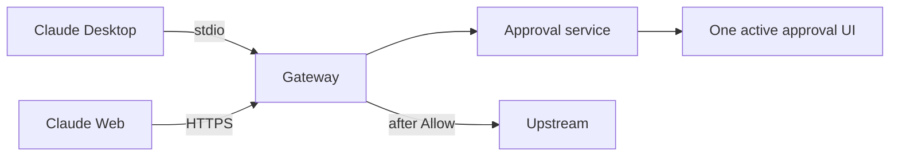

# Architecture

[Project README](../README.md)

## Request flow

## Components

- `guardian.py` and `src/guardian/cli.py`: command-line entry point.
- `gateway/`: stdio and HTTP request relays.
- `authorization/`: pending requests, deadlines, and decisions.
- `http/`: authenticated local service and HTTP handling.
- `ui/tkinter/`: desktop app; `ui/react/`: React source, dashboard server, and build assets.

## Approval sequence

1. Guardian validates and freezes a request.
2. The selected interface displays the exact request.
3. Allow forwards that request once. Block, timeout, disconnect, or expiry prevents execution.
4. The gateway returns the upstream result to Claude.

The broker keeps pending decisions in memory. It does not retry an upstream request after forwarding it. Upstream startup is outside per-request approval.

## Limits

Guardian protects only traffic routed through its gateway. It does not intercept other Claude connectors or translate between MCP protocol versions. Only one approval interface can hold the broker lease at a time.

